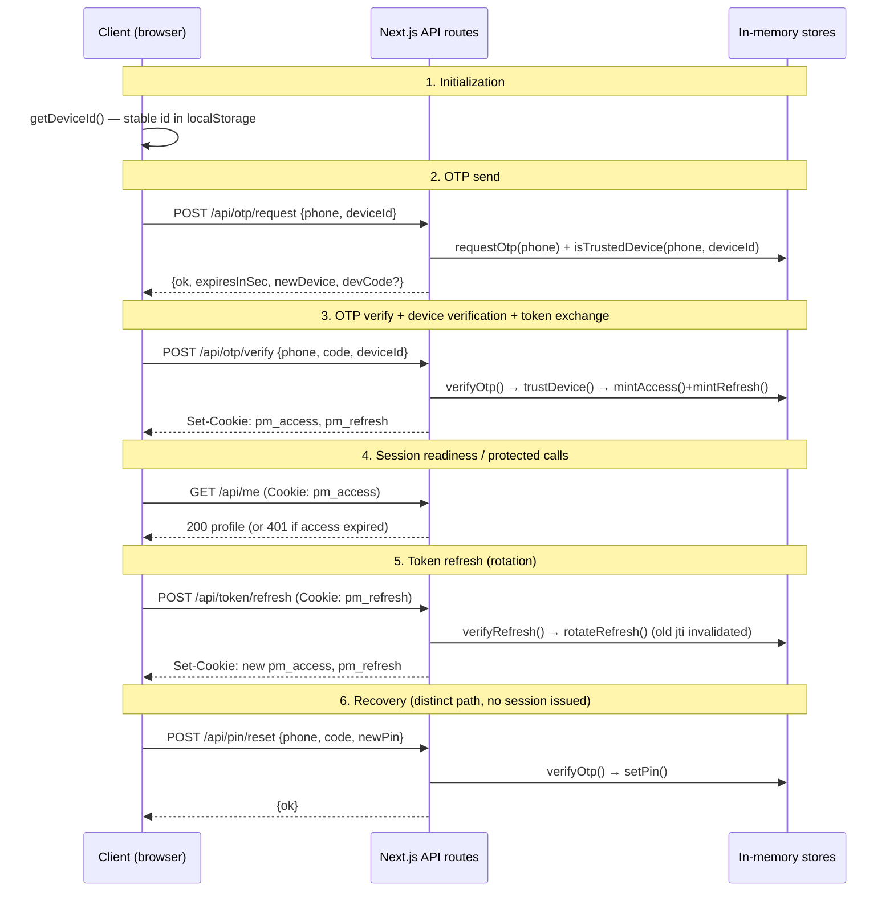

# Auth lifecycle (PayMock)

A **self-contained, simulated** authentication stack for a wallet-style app. No
SMS is sent and no third-party service is contacted — OTPs are generated locally
and surfaced in dev. This document maps each stage to the source file and method
that implements it, plus the request fields, headers, config and state involved.

> This models the *generic* stages a payments app needs (login, device
> verification, token exchange, refresh, recovery). It is not a reproduction of
> any specific provider's internal flow.

## Stage map

## Stages → source references

| Stage | Entry point | Core method(s) | Source |
| --- | --- | --- | --- |
| Initialization | client | `getDeviceId()` | [lib/device-id.ts](../lib/device-id.ts) |
| OTP send | `POST /api/otp/request` | `requestOtp()`, `isTrustedDevice()` | [pages/api/otp/request.ts](../pages/api/otp/request.ts), [lib/otp-store.ts](../lib/otp-store.ts), [lib/devices.ts](../lib/devices.ts) |
| OTP verify | `POST /api/otp/verify` | `verifyOtp()` | [pages/api/otp/verify.ts](../pages/api/otp/verify.ts) |
| Device verification | within verify | `trustDevice()`, `isTrustedDevice()` | [lib/devices.ts](../lib/devices.ts) |
| Token exchange | within verify | `mintAccess()`, `mintRefresh()` | [lib/tokens.ts](../lib/tokens.ts) |
| Session readiness | `GET /api/me`, `GET /api/session` | `verifyAccess()`, `verifyRefresh()` | [pages/api/me.ts](../pages/api/me.ts), [pages/api/session.ts](../pages/api/session.ts) |
| Token refresh | `POST /api/token/refresh` | `verifyRefresh()`, `rotateRefresh()` | [pages/api/token/refresh.ts](../pages/api/token/refresh.ts) |
| Logout | `POST /api/logout` | `revokeRefresh()`, `clearAuthCookies()` | [pages/api/logout.ts](../pages/api/logout.ts) |
| PIN set | `POST /api/pin/set` | `setPin()` | [pages/api/pin/set.ts](../pages/api/pin/set.ts), [lib/users.ts](../lib/users.ts) |
| Recovery (reset PIN) | `POST /api/pin/reset` | `verifyOtp()`, `setPin()` | [pages/api/pin/reset.ts](../pages/api/pin/reset.ts) |

**Login vs. the other flows** — these are deliberately separate paths:

- **Initial login**: `otp/request` → `otp/verify` → issues access + refresh.
- **Device verification**: same endpoints; `newDevice` is `true` until the device
  completes a verify, after which `trustDevice()` records it.
- **Token refresh**: no OTP; exchanges a valid refresh token for a new pair.
- **Recovery**: `otp/request` → `pin/reset`; verifies an OTP and sets a new PIN
  but **does not** issue a session.

## Request fields

| Endpoint | Body fields | Notes |
| --- | --- | --- |
| `POST /api/otp/request` | `phone`, `deviceId` | `phone` normalized to 10–15 digits |
| `POST /api/otp/verify` | `phone`, `code`, `deviceId` | `code` is 6 digits, single-use |
| `POST /api/token/refresh` | — | reads `pm_refresh` cookie |
| `POST /api/pin/set` | `pin` | 4–6 digits; requires `pm_access` |
| `POST /api/pin/reset` | `phone`, `code`, `newPin` | OTP-gated; no session issued |

## Headers & cookies

| Name | Direction | Purpose |
| --- | --- | --- |
| `Content-Type: application/json` | request | JSON body |
| `Set-Cookie: pm_access` | response | access token; `HttpOnly; SameSite=Lax`; 15 min |
| `Set-Cookie: pm_refresh` | response | refresh token; `HttpOnly; SameSite=Lax`; 30 days |
| `Allow` | response | sent with 405 on wrong method |

Cookies gain `Secure` automatically when `NODE_ENV=production`.

## Configuration sources

| Variable | Default | Effect |
| --- | --- | --- |
| `SESSION_SECRET` | insecure dev value | HMAC key for all tokens ([lib/crypto.ts](../lib/crypto.ts)) |
| `MOCK_OTP_CODE` | unset (random) | forces a fixed OTP code ([lib/otp-store.ts](../lib/otp-store.ts)) |
| `NODE_ENV` | — | `production` hides the dev code and sets `Secure` cookies |

Timing/limits (constants): OTP TTL 5 min, 5 attempts, 30s resend cooldown
([lib/otp-store.ts](../lib/otp-store.ts)); access TTL 15 min, refresh TTL 30 days
([lib/tokens.ts](../lib/tokens.ts)).

## State handling

All state is in-memory and process-local (resets on dev reload); each store is
stashed on `globalThis` so it survives hot reloads:

| Store | Shape | File |
| --- | --- | --- |
| OTP codes | `phone → {code, expiresAt, attempts, lastSentAt}` | [lib/otp-store.ts](../lib/otp-store.ts) |
| Refresh registry | `jti → {sub, did, exp, valid}` (rotation/revocation) | [lib/tokens.ts](../lib/tokens.ts) |
| Trusted devices | `phone → Set<deviceId>` | [lib/devices.ts](../lib/devices.ts) |
| Users / PIN | `phone → {pinHash, pinSalt}` (scrypt) | [lib/users.ts](../lib/users.ts) |

To make this production-grade, swap the in-memory stores for a datastore and the
OTP "send" for a real SMS provider — **for your own application**. The route,
token and UI layers stay unchanged.
